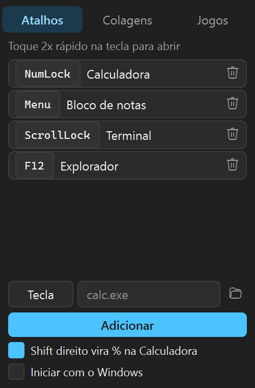
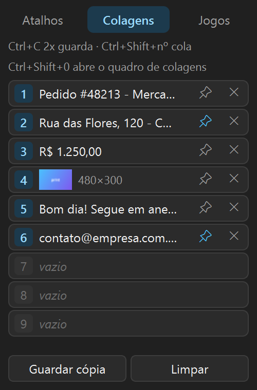
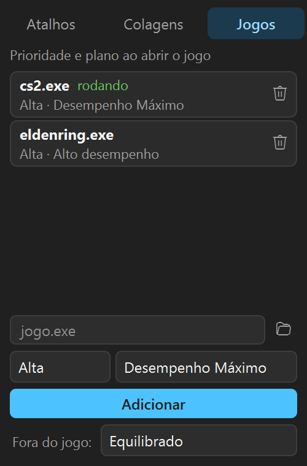
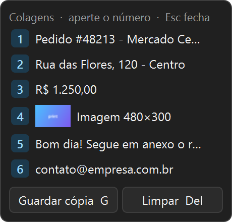
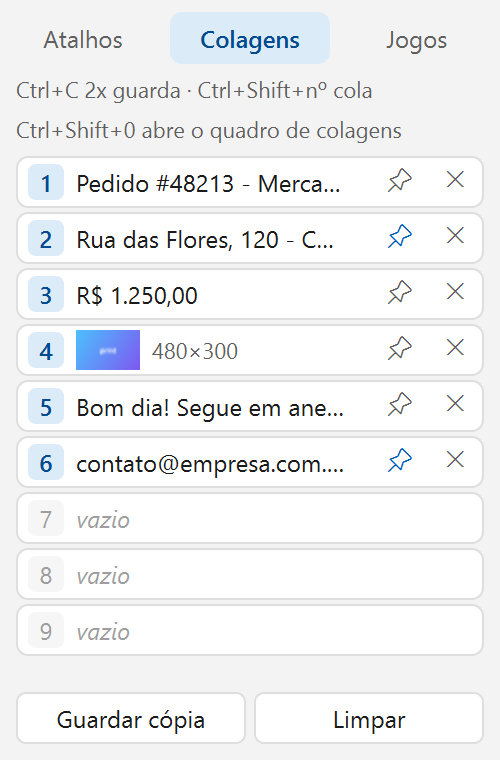

# Turbo Atalho

Utilitário Windows que fica na bandeja do sistema com três funções:
atalhos de toque duplo, slots de colagem e modo jogo.

<p align="center">
  
  
  
</p>

<p align="center">
  
  &nbsp;&nbsp;
  
</p>
<p align="center"><sub>Quadro de colagens (<code>Ctrl+Shift+0</code>) · o tema acompanha o claro/escuro do Windows</sub></p>

## Funcionalidades

### Atalhos
- Toque **duas vezes rápido** numa tecla (NumLock, Menu, F1–F12, Home…) para abrir um programa.
  Padrão: `NumLock` 2x abre a Calculadora (e o NumLock termina ligado).
- `Shift direito` vira `%` dentro da Calculadora do Windows.
- Opção **Iniciar com o Windows**.

### Colagens (9 slots)
| Ação | Atalho |
|------|--------|
| Guardar o que foi copiado no próximo slot livre | `Ctrl+C` duas vezes rápido |
| Colar o slot N | `Ctrl+Shift+1` … `Ctrl+Shift+9` |
| Quadro com todos os slots (aperte o número para colar) | `Ctrl+Shift+0` |
| No quadro: guardar o que está copiado / limpar não fixados | `G` / `Del` |

- Dá para segurar `Ctrl+Shift` e apertar vários números seguidos.
- Guarda **texto e imagem**. Os slots ficam salvos e continuam lá depois de reiniciar.
- Para imagens (print do `Win+Shift+S`, "Copiar imagem" do navegador): use **Guardar cópia**
  (botão na aba Colagens ou `G` no quadro), que guarda o que estiver na área de transferência.
- Cada número fica parado: só muda quando você guarda algo novo.
- Fixe um slot (ícone de pino) para ele não ser trocado nem apagado por "Limpar não fixados".
- Com todos os slots ocupados, a próxima cópia substitui o slot não fixado mais antigo.
- Na aba Colagens: clique copia o slot, duplo clique edita o texto.

### Jogos
- **Prioridade** (Normal / Acima do normal / Alta) gravada no registro do Windows
  (`Image File Execution Options\<jogo>.exe\PerfOptions`). Vale toda vez que o jogo abre,
  mesmo com o app fechado. Pede permissão de administrador (UAC) só ao adicionar ou remover.
- **Plano de energia**: quando o jogo abre, troca para o plano escolhido; quando fecha, volta para o plano "Fora do jogo".
  A lista de planos vem do próprio Windows (inclui "Desempenho Máximo" se existir).

## Tecnologias
- Python 3.13+
- [PySide6](https://doc.qt.io/qtforpython-6/) (Qt) — interface, bandeja e área de transferência
- [keyboard](https://github.com/boppreh/keyboard) — detecção de toque duplo e Ctrl+C duplo
- `RegisterHotKey` (API do Windows) — Ctrl+Shift+0..9
- [psutil](https://github.com/giampaolo/psutil) — detectar os jogos abertos

## Instalação e uso

### Pelo código-fonte
Requer [uv](https://docs.astral.sh/uv/).
```bash
uv sync
uv run main.py            # inicia na bandeja
uv run main.py --abrir    # inicia já com a janela aberta
```

### Gerando o executável
```bash
build.bat
```
O executável fica em `dist\TurboAtalho.exe`. Não precisa rodar como administrador.

## Configurações
Ficam em `%APPDATA%\TurboAtalho\`:
- `config.json` — atalhos, slots, jogos
- `slots\N.png` — imagens guardadas nos slots

Configurações da versão 3 são migradas automaticamente (cópia de segurança em `config.v1.json`).
